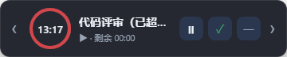

# DSHBar

> 适配 DSH 桌面端的 AI 原生轻量任务计时工具（参考 [WorkBar](https://github.com/Obsucre777/WorkBar)）。

一个常驻托盘的**顶部细线 / 悬浮任务卡**：平时只在屏幕顶部占一条 6px 的线，点一下展开成一个任务圆环卡片，显示当前任务的正计时或倒计时。同时内置 **MCP 服务器**，DSH 里的 AI 可以直接建任务、开始 / 暂停 / 完成计时，改动会实时反映在悬浮窗上。

- 🪟 无边框透明置顶窗口，占屏幕顶部正中，不抢焦点、不进任务栏
- ⭕ 圆环进度：正计时按小时填充（绿 → 黄 → 红），倒计时按剩余比例填充，超时红色闪烁
- 🖱️ 托盘菜单：显示 / 隐藏、中英切换、开机自启、全局快捷键、退出
- ⌨️ 全局快捷键 `Alt+W` 一键收起 / 展开（被占用时自动降级）
- 🤖 11 个 `dshbar_*` MCP 工具，AI 与桌面端共享同一个 `store.json`
- 🌏 中文 / English，默认跟随系统

---

## 1. 快速开始

### 直接用打包好的程序（推荐）

`release\win-unpacked\` 已经是可直接运行的完整程序（无需安装）：

1. 运行 `release\win-unpacked\DSHBar.exe` —— 屏幕顶部出现一条细线即为运行中，点击展开。
2. MCP 接入用同目录的启动器：`release\win-unpacked\resources\dshbar-mcp.cmd`。

也可以把 `release\win-unpacked\` 整个目录拷到任意位置运行；要让它出现在开始菜单/开机自启，再执行下面的安装版。

### 安装版（自行构建）

1. `D:\node\node.exe scripts\build-installer.cjs` 产出 `release\DSHBar Setup 0.1.0.exe`。
2. 安装器会把 `<安装目录>\resources` 加入用户 PATH，于是 `dshbar-mcp` 命令可用。

> **前置条件**：目标机器需要 **Node.js 18+**（MCP 服务器跑在独立 Node 进程里）。
> `dshbar-mcp.cmd` 会依次尝试 `%ProgramFiles%\nodejs\node.exe` → `%LOCALAPPDATA%\Programs\nodejs\node.exe` → PATH 中的 `node.exe` → `D:\node\node.exe`，都找不到时会在 stderr 明确报错。

### 源码版

```powershell
cd E:\herness\03\dshbar
npm install
npm run build          # 编译主进程 + 渲染层
npm start              # 启动桌面端（electron .）
npm run mcp            # 单独启动 MCP 服务器（stdio，调试用）
```

> 本机 `node` 是 harness 的 `node.cmd` 垫片（内部 `ELECTRON_RUN_AS_NODE=1` 调 `DSH Desktop.exe`），会让 electron-builder 的 argv 解析失败。**打包时请直接用 `D:\node\node.exe`**：
> ```powershell
> D:\node\node.exe scripts\build-and-dir.cjs
> ```

---

## 2. 界面操作



| 操作 | 效果 |
| --- | --- |
| 点击顶部细线 | 展开任务卡（360×42） |
| 点击 `—` | 收起为细线（360×6） |
| 点击 `⏸ / ▶` | 暂停 / 继续当前任务计时 |
| 点击 `✓` | 完成当前任务 |
| 点击 `‹ / ›` | 在同组任务间切换（自动跳过已取消的任务） |
| 按住卡片空白处拖动 | 窗口变圆形时间盘跟着光标走，松手落回长条（见下方说明） |
| `Alt+W` | 全局收起 / 展开 |

异常状态：超时（倒计时走完）圆环**画满一圈红色并闪烁**；已取消任务显示灰色 `✕ 已取消`，完成按钮禁用。

### 关于吸附与拖动（v0.1.6 / v0.1.7）

两条形态规则，都跟窗口贴在屏幕的哪一侧有关：

- **吸附边跟随**：窗口贴着工作区**上边**时，收起的 6px 细线画在窗口顶部；贴**下边**时画在窗口底部。靠下边时窗口是「底边不动、向上生长」的，所以展开 / 收起细线始终咬在屏幕下沿，不会往上飘。离开上下边（`dock-free`）则按顶部对齐。窗口任何移动之后都会被夹回工作区（`workArea` 已排除任务栏），**不会压住任务栏**。
- **拖动变圆盘**：按住卡片拖动时，窗口会收成 64×64 的圆形时间盘，中间只留时间环与时间数字，松手后按光标位置落回 360×宽度，并重新判断吸附边。长条被塞进正方形会左右裁切，圆形不会。

实现要点（v0.1.7 改）：

- **位置只有一个来源**。v0.1.6 用的是系统原生拖动（`-webkit-app-region: drag`）：位置由 Windows 的移动循环托管，它按拖动开始时记下的「抓取偏移」摆窗口；我们同时把窗口缩成 64×64 并居中到光标，两边各自纠正对方，每帧都差一个偏移量 —— 表现就是圆盘在光标两侧**左右来回闪**。现在渲染层负责 `pointerdown / pointerup`，主进程每 16ms 读一次 `screen.getCursorScreenPoint()` 把窗口摆到光标正中央，没人跟它抢位置。
- **4px 位移阈值**：只点一下卡片不搬窗口；按钮上按下也不算拖动，点 `⏸ / ✓` 不会被缩成圆。
- **指针捕获**：拖动中窗口被夹在工作区内，光标可能跑到圆盘外面，靠 `setPointerCapture` 保证收得到 `pointerup`。

### 关于拖动（历史：v0.1.2 修「移动时被拉长」）

v0.1.2 之前是渲染层自己算 `dx/dy` 再 `ipcRenderer.invoke('window:move')` 让主进程调 `setPosition`，有两个缺陷：

1. **残影 / 被拉长**：本机 GPU 进程不可用时窗口走软件渲染，透明窗口在每秒几十次的 `setPosition` 下每帧都要重新合成，视觉上就是卡片被拉长、拖出一串残影。
2. **越拖越偏**：`MouseEvent.screenX` 是 CSS 像素，而 `setPosition` 收的是 DIP，缩放比例不是 100% 时两者不相等。

v0.1.2 改成系统原生拖动，v0.1.7 又换回「渲染层拿指针 + 主进程定位」——但这次位置完全由主进程用 `screen.getCursorScreenPoint()`（DIP）计算，既不经过渲染层的 CSS 像素，也不和 Windows 的移动循环抢方向盘。`window:move` 通道仍保留但已不再使用。

同时保留：展开 / 收起不再把窗口重新居中到主屏（原来在副屏或用惯某位置后，一收起就跳回屏幕中间），现在保持当前位置，只改高度。

---

## 3. 接入 DSH（MCP）

在 DSH 客户端的 MCP 配置里加入：

```json
{
  "mcpServers": {
    "dshbar": {
      "command": "dshbar-mcp",
      "type": "stdio",
      "args": []
    }
  }
}
```

若 `dshbar-mcp` 不在 PATH，用绝对路径：

```json
"command": "C:\\Users\\<你>\\AppData\\Local\\Programs\\DSHBar\\resources\\dshbar-mcp.cmd"
```

> DSH 读取的是它**启动时**的 PATH。如果 DSH 在装 DSHBar 之前就已经在跑，需要重启一次 DSH 客户端。

验证：在对话里让 AI 调用 `dshbar_get_status`，返回 `ok: true` 即接入成功。

完整的接入说明、参数、故障排查见 [`src/mcp/install.md`](src/mcp/install.md)；给 AI 的行为纪律（"只记录有跟踪价值的任务 + 静默记录"）见 [`src/mcp/prompt.md`](src/mcp/prompt.md)，可粘进系统提示。

### 让 DSH 对话真正"自动记录"（最常见的问题）

MCP 只解决"能记"，**记不记由模型决定**。没告诉 AI 该记任务时，悬浮条会永远停在
「暂无任务 · 在 DSH 中创建」——工具是通的，只是模型不知道有这条纪律。

DSH 桌面端内置了 `dsh-agent-instructions` 插件：每次会话第一次请求前，它会把
**用户全局指令文件**和项目级 `AGENTS.md` / `CLAUDE.md` 注入成一条 `<system-reminder>`。
所以最省事的做法是写一份全局指令：

```text
%APPDATA%\dsh-desktop\harness\AGENTS.md      # $DSH_HOME/AGENTS.md，对本机所有会话生效
```

内容照 `src/mcp/prompt.md` 的纪律写，一句话版：

> 开始多步实质工作（改代码、写报告、排障…）前用 `mcp__dshbar__dshbar_start_work`
> 记一条中文短标题，做完 `dshbar_finish_work`；闲聊、单次问答、纯查询不记；
> 静默记录，不在回复里提 DSHBar。

这份文件由 DSH 读取，DSHBar 不校验它；改完不用重启 DSH，下一次请求就对账生效。
其它客户端（Claude Code / Codex / Cursor…）没有这套注入机制，把同样的文字粘进
系统提示或项目规则即可。

> 新任务到来时，悬浮条会自动从 6px 细线**展开并置顶**，不会再"数据有了但看不见"。

### 工具一览（11 个）

| 工具 | 作用 |
| --- | --- |
| `dshbar_start_work` | 新建任务并立即开始计时（`title`、可选 `estimated_seconds`） |
| `dshbar_pause_work` | 暂停指定任务 |
| `dshbar_resume_work` | 继续指定任务 |
| `dshbar_finish_work` | 完成指定任务（可写 `note`） |
| `dshbar_abort_work` | 取消指定任务（可写 `reason`） |
| `dshbar_add_tasks` | 批量添加待办任务（不开始计时） |
| `dshbar_list_tasks` | 列出任务（可按 `status` 过滤、`limit` 限制） |
| `dshbar_update_task` | 改标题 / 预计时长（`estimated_seconds: null` 即改成正计时） |
| `dshbar_reorder_tasks` | 按 `task_ids` 重排顺序 |
| `dshbar_delete_task` | 删除任务 |
| `dshbar_get_status` | 读取整体统计（总数、进行中、已完成等） |

---

## 4. 架构

```
┌─────────────────────────┐        ┌──────────────────────────┐
│  DSHBar.exe (Electron)  │        │  dshbar-mcp.cmd          │
│  托盘 / 悬浮窗 / 热键    │        │  → node cli.js (stdio)   │
└───────────┬─────────────┘        └────────────┬─────────────┘
            │                                   │
            └──────────► store.json ◄───────────┘
              %APPDATA%\DSHBar\store.json      （原子写 + 写前重读）
```

- **两个进程完全解耦**：桌面端与 MCP 服务器互不依赖，只共享一份 JSON 存储；任一方没跑，另一方仍能工作。
- **原子写**：先写 `store.json.tmp-<pid>` 再 `rename`，任何时刻读到的都是完整文件。
- **实时同步**：两端都 `fs.watch` 存储目录（按文件名过滤 + 150ms 去抖），改动即时反映到悬浮窗。
- **MCP 绝不跑在 Electron 里**：Electron 主进程接不到管道 stdin，Chromium 也拒绝未注册的命令行开关，所以 MCP 只能由 `dshbar-mcp.cmd` 以真正的 Node 进程启动（详见 `BUILD_PACK.md` §4）。

### 计时语义（最容易踩坑的地方）

任务是「计时中」时，两个进程都会碰同一份数据，必须约定**唯一**的时间模型：

| 字段 | 含义 |
| --- | --- |
| `elapsedSeconds` | **已结束**的计时段累计秒数（不含当前正在跑的那一段） |
| `startedAt` | 当前计时段的开始时间（ISO）；非 running 时为 `null` |

于是任意时刻「已投入秒数」= `elapsedSeconds + (now - startedAt)`。

推论：

- running 期间**任何一方都不直接把秒数加到 `elapsedSeconds`**，否则 GUI 按秒累加 + MCP 按 `now - startedAt` 推算会各算一遍，时间翻倍。
- 需要落盘时用「段折叠」：`elapsedSeconds += now - startedAt` 且 `startedAt = now`。折叠前后「已投入秒数」不变，所以谁在什么时候读都一致。
- GUI 每秒折叠一次落盘（崩溃也不丢进度），落盘前先读盘合并；**合并时状态以磁盘为准**，只有双方都是 running 才取更长的那份计时进度。这样 MCP 刚标记为「暂停 / 完成」的任务不会被 GUI 的计时写回 running。
- 暂停 / 完成 / 取消时，先把当前段折叠进 `elapsedSeconds` 并清空 `startedAt`。

### 目录

```
dshbar/
├─ src/
│  ├─ main/main.ts          # Electron 主进程：窗口 / 托盘 / 热键 / 自启 / IPC
│  ├─ preload/preload.ts    # contextBridge 暴露的最小 API
│  ├─ renderer/             # 悬浮窗渲染层（原生 TS + CSS + SVG 圆环）
│  ├─ shared/               # types.ts / store.ts / i18n.ts（主进程、预加载、MCP 共用）
│  └─ mcp/                  # cli.ts（MCP 服务器）+ install.md + prompt.md
├─ build/
│  ├─ dshbar-mcp.cmd        # MCP 启动器（作为 extraResources 直接打包）
│  ├─ installer.nsh         # 安装器：加 PATH + 广播环境变量
│  ├─ uninstaller.nsh       # 卸载器：从 PATH 移除
│  └─ mcp-runtime/          # 由 build-mcp-bundle.cjs 生成的自包含 MCP 运行目录
├─ scripts/                 # 构建 / 打包 / 图标 / 端到端验证脚本
├─ assets/                  # 图标（icon.ico / tray.ico / trayTemplate.png）
├─ BUILD_SHELL.md           # 桌面端设计说明
├─ BUILD_MCP.md             # MCP 服务器设计说明
└─ BUILD_PACK.md            # 打包与安装器说明
```

---

## 5. 构建与验证

> 本机 PATH 上的 `node` 是 harness 的 `node.cmd` 垫片，会让 electron-builder 的 argv 解析失败。**统一用 `D:\node\node.exe`** 调用。

| 命令 | 说明 |
| --- | --- |
| `npm run build` | 编译主进程 / 预加载 / MCP + 渲染层，并拷贝渲染资源 |
| `npm run icons` | 用 Pillow 重新生成全部图标 |
| `npm run mcp:bundle` | 生成 `build/mcp-runtime/`（自包含依赖闭包，目录名必须是 `vendor`，否则 electron-builder 会剔除） |
| `node scripts/build-and-dir.cjs` | **推荐**：一键编译 + 生态 `release/win-unpacked/`（不打包安装器，最快） |
| `npm run dist` | 产出 NSIS 安装器（需要联网下载 makensis） |
| `npm run dist:installer` | **离线 NSIS 安装器**：用本地缓存的 makensis 直接编译 `build/installer-standalone.nsi`，不执行安装包、任何环境都能出成品 |
| `npm run dist:portable` | 产出免安装单文件 |
| `node scripts/mcp-smoke.mjs` | MCP 协议层自测（7 项） |
| `node scripts/launcher-verify.mjs` | 用**打包产物**的 `dshbar-mcp.cmd` 跑完整 stdio 会话 |
| `node scripts/sync-verify.cjs` | **GUI ↔ MCP 双向同步**：起真实 Electron 窗口 + MCP 进程，验证计时推进、暂停、恢复、完成 |

四道验证全部通过（本仓库当前状态）：

```
tsc -p tsconfig.json            exit 0
tsc -p tsconfig.renderer.json   exit 0
node scripts/mcp-smoke.mjs      SMOKE OK               (7/7 PASS)
node scripts/launcher-verify.mjs  LAUNCHER VERIFY: PASS
node scripts/sync-verify.cjs    SYNC VERIFY: PASS      (6/6)
```

### 环境变量

| 变量 | 作用 |
| --- | --- |
| `DSHBAR_STORE` | 覆盖 store 文件完整路径（默认 `%APPDATA%\DSHBar\store.json`） |
| `DSHBAR_USER_DATA` | 覆盖 Electron 的 userData 目录（`%APPDATA%\DSHBar\userdata` 不可写时的逃生通道） |
| `DSHBAR_GPU=1` | 重新开启硬件加速（默认关闭，见下面的「启动不了」） |
| `DEBUG_DSHBAR=1` | 额外把细节写进 `<store 目录>\trace.log` |

### 存储位置与排障

- 数据文件：`%APPDATA%\DSHBar\store.json`
- 错误日志：`%APPDATA%\DSHBar\error.log`
- **启动轨迹：`%APPDATA%\DSHBar\startup.log`（每次启动重写，不需要任何开关）**
- Chromium 自己的 profile：`%APPDATA%\DSHBar\userdata\`（不和数据文件混在一起）
- 写盘失败不会导致崩溃：桌面端会保留内存副本继续可操作

### 「双击没反应 / 启动不了」怎么查

按顺序看三处：

1. **`%APPDATA%\DSHBar\startup.log`** —— 有内容说明主进程已经跑起来了，最后一行会告诉你走到了哪一步（`bootstrap: window created` / `window revealed via ...`）。
2. **屏幕顶部中间** —— 首次运行会**展开**成完整卡片；之后默认收起成一条 6px 的蓝色细线（`Alt+W` 或点细线展开）。
3. **Windows 事件查看器 → Windows 日志 → 应用程序** —— 如果有 `DSHBar.exe` 的「应用程序错误」，记下**异常代码**：

| 现象 | 原因 | 处理 |
| --- | --- | --- |
| 事件日志异常代码 `0x80000003`，且没有 startup.log | Chromium 的 GPU 进程起不来，Electron 直接 `FATAL: ... GPU process isn't usable. Goodbye.` | 已默认关闭 GPU（`app.disableHardwareAcceleration()`）。仍复现就用同目录的 **`DSHBar-兼容模式.cmd`** 启动；它会再叠加 `--disable-gpu*` 并把 Chromium 原始输出写到 `%LOCALAPPDATA%\DSHBar\console.log` |
| 有 startup.log，最后一行是 `no lock -> notify and quit` | 已经有一个实例在跑（或单实例锁写不进去） | 看系统托盘；或结束所有 `DSHBar.exe` 进程后重试 |
| 有 startup.log，最后一行是 `bootstrap: window created` 之后没有 `window revealed` | 窗口已建但没显示 | 用 `DEBUG_DSHBAR=1` 重跑，把 `trace.log` 发出来 |

> 显卡驱动更新后想恢复硬件加速：`set DSHBAR_GPU=1` 再启动。

---

## 6. 已知限制

1. **需要 Node.js 18+**：MCP 服务器以独立 Node 进程运行（Electron 主进程接不到管道 stdin，所以不能塞进 DSHBar.exe）。若希望目标机器免安装 Node，需要在安装器里打包一个便携版 `node.exe`（见 `BUILD_PACK.md` 的风险说明）。
2. **NSIS 安装器两条路线**：`npm run dist`（electron-builder）产安装包的最后一步需要**执行**刚生成的安装器来产出卸载器，在受限 / 无桌面会话里会失败（`... Setup x.y.z.exe process failed 2`）。改用 `npm run dist:installer`：独立脚本 `build/installer-standalone.nsi` 用 `WriteUninstaller`（安装时才生成卸载器），makensis 直接编译本地缓存的 NSIS，**任何环境都能出成品**，行为与 electron-builder 版对齐（per-user 安装、快捷方式、卸载注册表项、PATH 追加与精确移除）。
3. **免安装版不进 PATH**：`release\win-unpacked\` 不会注册 `dshbar-mcp`，需要在 DSH 配置里写 `resources\dshbar-mcp.cmd` 的绝对路径。
4. **仅 Windows**：窗口定位、托盘、开机自启均按 Windows 实现。
5. **GUI 需要可写的 userData 目录**：若 `%APPDATA%` 只读，请设置 `DSHBAR_USER_DATA` 指向可写目录，否则 Chromium 会在初始化 profile 时静默退出（程序会尝试自动回退到其它候选目录）。
6. **自动记录取决于模型是否遵守指令**：DSH 侧只保证把 `AGENTS.md` 注入到上下文，模型仍可能漏记；漏记时悬浮条是空的，不是 DSHBar 的 bug。想强制记录只能在服务端加钩子（DSH 的 `dsh-hook-protocol` 或自定义插件），见 README §3。

### 安装器脚本里已修复的两个 NSIS 缺陷

海象编译校验真正跑起来之后才暴露出来的：

| 缺陷 | 现象 | 修复 |
| --- | --- | --- |
| 卸载段调用安装段函数 | `Call must be used with function names starting with "un." in the uninstall section.` | 卸载器另建 `un.DSHBar_FindSubstring` / `un.DSHBar_PathRemoveEntry` |
| 安装专用 helper 在卸载器那一遍未引用 | `warning 6010: install function ... not referenced` + electron-builder 把 warning 当 error | 用 `!ifndef BUILD_UNINSTALLER` / `!ifdef BUILD_UNINSTALLER` 分别包裹两组函数 |

---

## License

MIT
